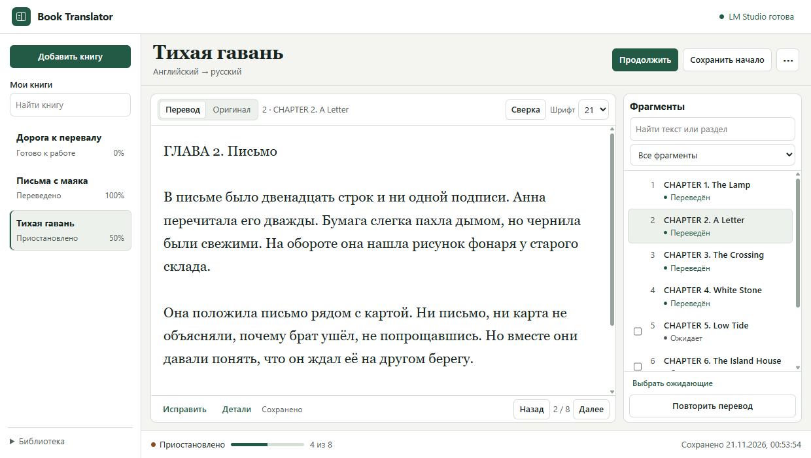
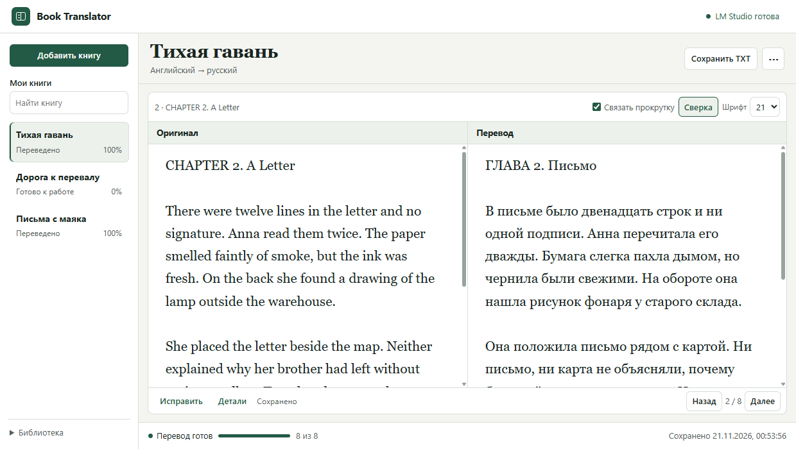
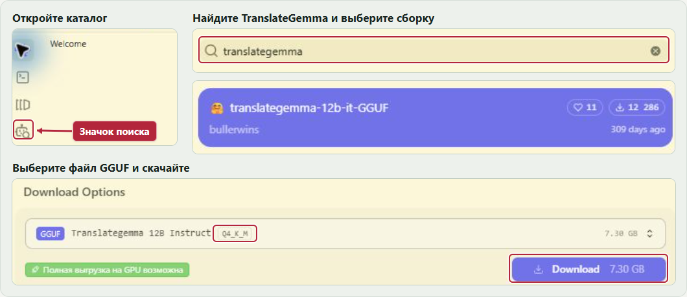
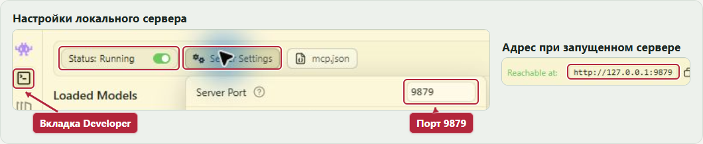
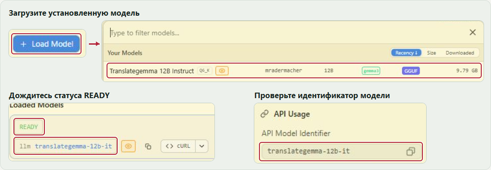
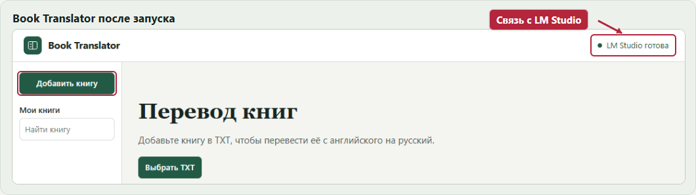
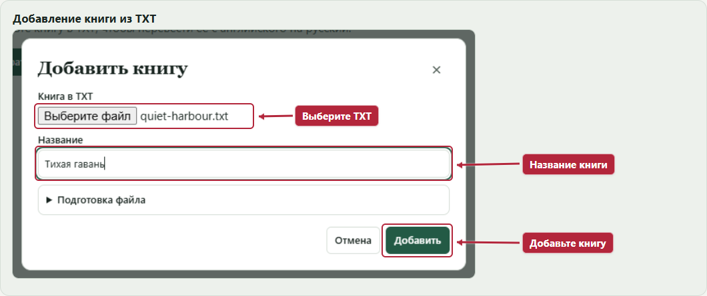
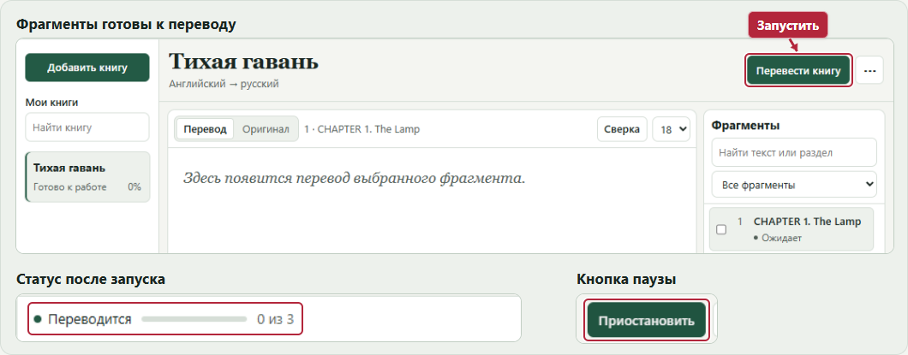
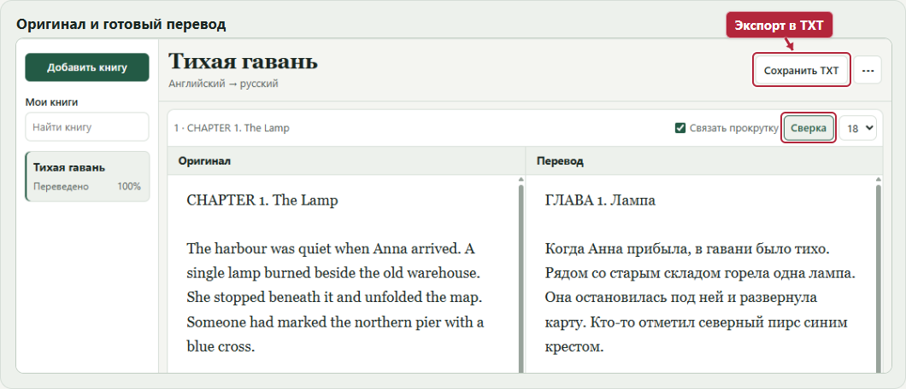

# Book Translator

Book Translator — приложение для Windows, которое переводит TXT-книги с английского на русский. Перевод можно приостановить, продолжить с сохранённого места, сверить с оригиналом и выгрузить в TXT.

[Устройство проекта](#как-устроен-проект) · [Интерфейс](#интерфейс) · [Первый перевод](#первый-перевод) · [Чтение и сохранение](#чтение-и-сохранение) · [Если что-то не работает](#если-что-то-не-работает)

## Как устроен проект

- **JavaScript, HTML и CSS** работают в окне **pywebview** на WebView2 и обращаются к серверу на локальном адресе.
- **Python 3.11 и FastAPI** принимают TXT, делят текст на фрагменты и управляют фоновой задачей перевода. Задача отправляет фрагменты в **LM Studio** через OpenAI-совместимый API. По умолчанию используется TranslateGemma 12B на том же компьютере.
- **SQLite** хранит очередь, готовые фрагменты и версии перевода в отдельной базе для каждой книги. После паузы приложение продолжает с оставшихся фрагментов.

## Интерфейс

В библиотеке виден прогресс каждой книги. Справа можно найти фрагмент, проверить его статус или выбрать несколько фрагментов для перевода.

Режим **Сверка** открывает оригинал и перевод рядом. Здесь можно исправить текст, а готовый результат сохранить в TXT.

## Что понадобится

- Windows 10 или 11 (64 бита).
- Python 3.11. При установке оставьте включённым компонент **Python Launcher** (`py`). [Установщик Python для Windows](https://www.python.org/downloads/release/python-3119/)
- LM Studio и свободное место для модели. [Скачать LM Studio](https://lmstudio.ai/download)
- Microsoft Edge WebView2 Runtime для окна приложения. [Страница загрузки WebView2](https://developer.microsoft.com/en-us/microsoft-edge/webview2/#download)

На странице проекта нажмите **Code → Download ZIP** и распакуйте архив целиком. Интернет понадобится для загрузки модели и установки зависимостей. [Как скачать ZIP с GitHub](https://docs.github.com/en/repositories/working-with-files/using-files/downloading-source-code-archives)

## Первый перевод

### 1. Скачайте TranslateGemma 12B

Если TranslateGemma 12B уже скачана, переходите к шагу 2.

1. На стартовом экране LM Studio нажмите значок поиска моделей в левой панели.
2. Введите `translategemma` и выберите сборку **TranslateGemma 12B Instruct** для LM Studio, например в формате **GGUF**. [Карточка модели Google](https://huggingface.co/google/translategemma-12b-it)
3. В **Download Options** выберите вариант, который подходит вашему компьютеру. На скриншоте показан пример **Q4_K_M** (около 7,3 ГБ). Нажмите **Download** и дождитесь окончания скачивания. [Как выбрать вариант в LM Studio](https://lmstudio.ai/docs/app/basics/download-model)

### 2. Запустите сервер и загрузите модель в память

1. Откройте вкладку **Developer** в левой панели. Нажмите **Server Settings**.
2. Проверьте **Server Port**. В настройках Book Translator по умолчанию указан `9879`. Можно использовать текущий порт LM Studio. [Настройки сервера LM Studio](https://lmstudio.ai/docs/developer/core/server/settings)
3. Включите сервер, если он выключен. Проверьте **Status: Running** и посмотрите адрес в поле **Reachable at**.

Если LM Studio работает на другом порту, откройте `config.yaml` в распакованной папке. В строку `base_url` раздела `lmstudio` впишите адрес из **Reachable at** и добавьте `/v1` в конце. Например, для порта `1234` укажите `http://127.0.0.1:1234/v1`. [Файл config.yaml](config.yaml)

Нажмите **+ Load Model**, выберите скачанную **TranslateGemma** и дождитесь статуса **READY**. На этом снимке для примера загружен вариант **Q6_K**.

В правой панели проверьте поле **API Model Identifier**. Если значение отличается от `translategemma-12b-it`, откройте `config.yaml` в распакованной папке и вставьте это значение в строку `model` раздела `lmstudio`. Сделайте это до добавления книги. [Файл config.yaml](config.yaml)

### 3. Откройте Book Translator

1. При первой установке дважды щёлкните `Book Translator.bat` в распакованной папке. Он установит зависимости. Дождитесь сообщения `Installation completed` и нажмите любую клавишу, чтобы закрыть окно установки.
2. Откройте файл `Запустить переводчик.bat`. Проверьте, что в правом верхнем углу появилось **LM Studio готова**. Оставьте LM Studio открытой на время перевода.

### 4. Добавьте английский TXT

1. Нажмите **Добавить книгу**, затем **Выберите файл**.
2. Укажите английский TXT. Для первой пробы подойдёт `quiet-harbour.txt` из папки `docs/quickstart`. [Тестовый рассказ](docs/quickstart/quiet-harbour.txt)
3. При желании измените название и нажмите **Добавить**.

Приложение само разделит текст на фрагменты. В разделе **Подготовка файла** можно проверить исходник, сменить кодировку или выбрать ручную разметку.

### 5. Запустите перевод

Нажмите **Перевести книгу**. Внизу появится статус **Переводится** и счётчик готовых фрагментов. Когда работа закончится, внизу появится **Перевод готов**, а вверху станет доступна кнопка **Сохранить TXT**.

Чтобы сначала оценить перевод нескольких фрагментов, откройте **Действия с книгой (⋯) → Пробный перевод** и подтвердите **Перевести пробу**. Результат сохранится. Если после пробы остались фрагменты, нажмите **Продолжить**.

## Чтение и сохранение

- **Сохранить TXT** выгружает готовый перевод в отдельный файл. Когда начало книги уже переведено, **Сохранить начало** позволяет выгрузить текст до первого пропуска.
- **Сверка** показывает оригинал и перевод рядом. Повторное нажатие возвращает список **Фрагменты**, где можно искать по разделам и тексту. Снимите галочку **Связать прокрутку**, если хотите прокручивать колонки отдельно.
- **Исправить** открывает редактор. По кнопке **Детали** доступны вычитка, заметки и сохранённые версии.
- **Приостановить** останавливает перевод после обработки текущего ответа модели. Чтобы вернуться к книге позже, откройте её и нажмите **Продолжить**.

## Архив и резервные копии

В меню **Действия с книгой → Свойства и копии** можно переименовать книгу, отправить её в архив или создать резервную копию. Чтобы вернуть книгу из архива, включите **Библиотека → Показать архив**, откройте свойства книги и нажмите **Вернуть из архива**.

В папке `backups` сохраняются ZIP-копии с исходником, версиями перевода и историей. Чтобы загрузить такую копию как отдельную книгу, откройте **Библиотека → Восстановить копию** и выберите ZIP. Рабочие данные книг хранятся в `projects`, а собранные TXT — в `output`.

## Если что-то не работает

| Что произошло | Что проверить |
| --- | --- |
| Установка зависимостей завершилась ошибкой | В PowerShell выполните `py -3.11 --version`. Если команда не находит Python 3.11, установите его с Python Launcher. Проверьте доступ в интернет и повторите установку зависимостей. |
| В углу отображается **Проверить LM Studio** | Наведите указатель на надпись, чтобы увидеть подсказку. Проверьте **Status: Running** у сервера и **READY** у модели. Нажмите надпись, чтобы проверить связь повторно. |
| Переводчик обращается к другому порту | Сверьте адрес и порт в `lmstudio.base_url` с адресом из **Developer**. В `config.yaml` адрес должен оканчиваться на `/v1`. [Файл config.yaml](config.yaml) |
| Модель для открытой книги недоступна | Идентификатор модели указан в **Действия с книгой → Свойства и копии → Подключение**. Загрузите в LM Studio модель с этим идентификатором. Значение `lmstudio.model` из файла настроек используется при добавлении новых книг. |
| Перевод остановился с ошибкой | Выберите фрагмент с ошибкой и нажмите **Детали**, чтобы прочитать сообщение. После устранения причины нажмите **Продолжить**. Перевод возобновится с оставшихся фрагментов. |

Командная строка и тесты

Команды выполняются в PowerShell из папки проекта. Вместо `book.txt` укажите путь к вашей книге.

~~~powershell
.\.venv\Scripts\python.exe book_translator.py models
.\.venv\Scripts\python.exe book_translator.py translate "book.txt" --max-chunks 3
.\.venv\Scripts\python.exe book_translator.py translate "book.txt"
.\.venv\Scripts\python.exe book_translator.py assemble "book.txt" --partial
.\.venv\Scripts\python.exe -m unittest discover -v
~~~

Тесты используют временные книги и подменяют модель. Для HTTP-проверок тестовый сервер запускается на локальном адресе.

